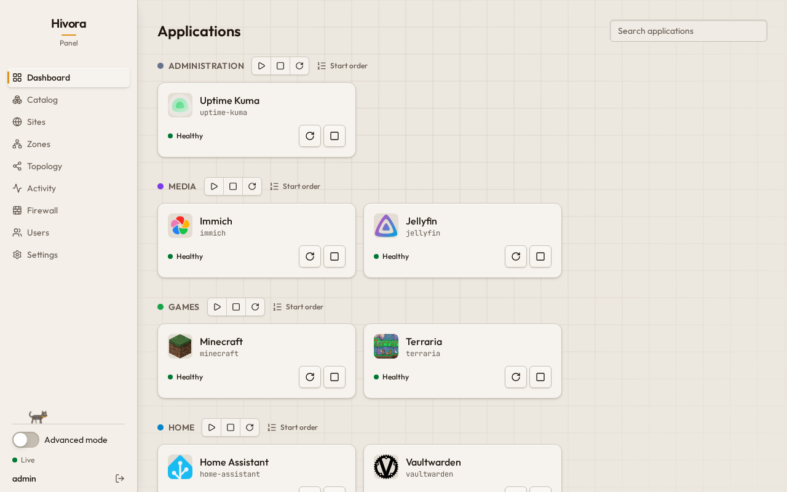
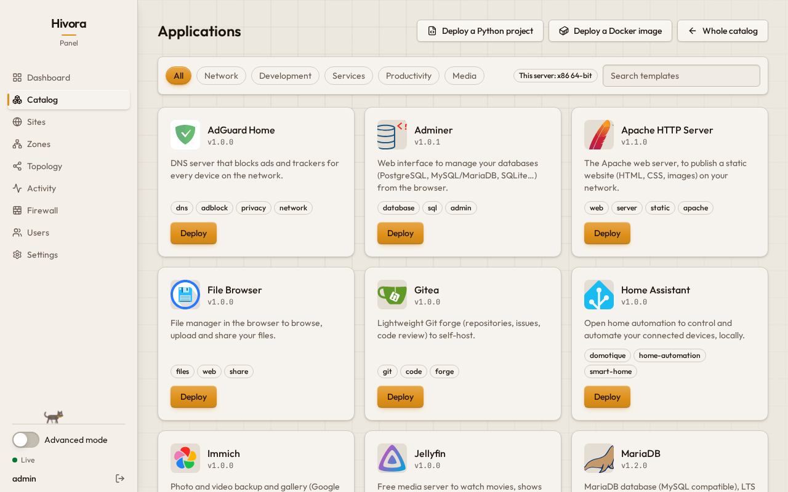
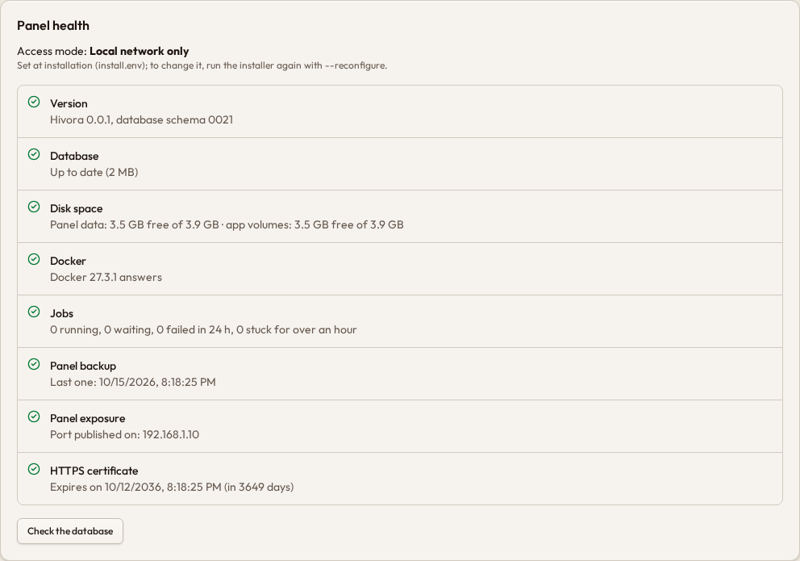

# Hivora

[](LICENSE)
[](https://github.com/hiidenops/hivora/releases)
[](https://github.com/hiidenops/hivora/actions/workflows/ci.yml)

## Hivora in a few words

Hivora is a self-hosted web panel for one Linux machine: install apps and game servers
from a catalog, run them with Docker, organize them in zones, reach the panel through its
own WireGuard VPN, and keep everything backed up. One container, one command to install,
in French or English.

## Key features

- **Catalog**: apps (Nextcloud, Jellyfin, Immich, Vaultwarden, Home Assistant, …), databases
  and game servers (Minecraft and its modpacks, Valheim, Palworld, Terraria, …), or any
  Docker image
- **Zones and topology**: group apps, link their networks, see what is exposed and how
- **Admin VPN**: the panel reachable through WireGuard only, with a QR code to scan
- **Backups**: per app, on demand or scheduled; every change is a revision you can go back to
- **Host firewall**: UFW rules, fail2ban, blocked addresses, static routes
- **Panel health and updates**: disk, Docker, jobs, exposure, available versions
- **Users and roles**, two-factor authentication, an audit log

## Quick install

On Debian 12+, Ubuntu 22.04+ or Raspberry Pi OS 64-bit (amd64 or arm64), as root:

```sh
curl -fsSL https://github.com/hiidenops/hivora/releases/latest/download/install.sh | sudo sh
```

The installer sets up Docker if needed, asks for its language and how you will reach the
panel, then prints the URL and the admin password. Options, automated installs and checking
the script: [docs/installation.md](docs/installation.md).

## Access modes

| Mode | Reach the panel |
|---|---|
| Local network only | from your local network |
| Local network + VPN (default) | from your network, and from anywhere through WireGuard |
| Only through the VPN | through WireGuard only |
| Internet (advanced) | from everywhere; two-factor authentication is mandatory |

On a machine with a public IP only (a VPS), the default is *Only through the VPN*. Change
the mode later with `--reconfigure`. Details: [docs/admin-vpn.md](docs/admin-vpn.md).

## First login

Sign in as `admin` with the password the installer printed (it is shown once), then choose
your own. Turn on two-factor authentication in **Settings**. The certificate is
self-signed: your browser warns once, that is expected.

## Screenshots

| Dashboard | Catalog | Panel health |
|---|---|---|
|  |  |  |

## Documentation

- [Installation](docs/installation.md): requirements, options, access modes, Docker Compose
- [Admin VPN](docs/admin-vpn.md): how it works, connecting a device, lost access
- [Updating](docs/updating.md): new versions, updating, rollback
- [Backups](docs/backups.md): the panel, the apps, moving to another machine
- [Troubleshooting](docs/troubleshooting.md): logs, lost password or two-factor device
- [Uninstalling](docs/uninstall.md)

Release history: [CHANGELOG.md](CHANGELOG.md) (in French) and the
[GitHub Releases](https://github.com/hiidenops/hivora/releases), whose notes come from it.

## Security

Hivora controls Docker on its machine, which amounts to root access: keep the panel on your
local network or behind its VPN, and turn on two-factor authentication. Docker bypasses
UFW. The panel contacts third parties only for what you use: GitHub (new versions, can be
turned off), `api.ipify.org` (the public address), image registries and the catalog's
sources.

Please report vulnerabilities privately:
[Report a vulnerability](https://github.com/hiidenops/hivora/security/advisories/new)
(see [SECURITY.md](SECURITY.md)).

## License

[AGPL-3.0](LICENSE). The panel links to the source code of the version it runs.

## Development

The server is Python (FastAPI, SQLite), the panel Next.js; tests run without a real Docker:

```sh
cd backend && uv run pytest -q
cd frontend && npm ci && npm test && npx playwright test
```

More: [docs/development.md](docs/development.md) and [docs/releasing.md](docs/releasing.md).
