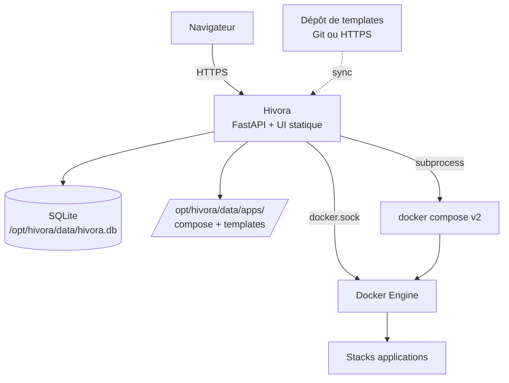
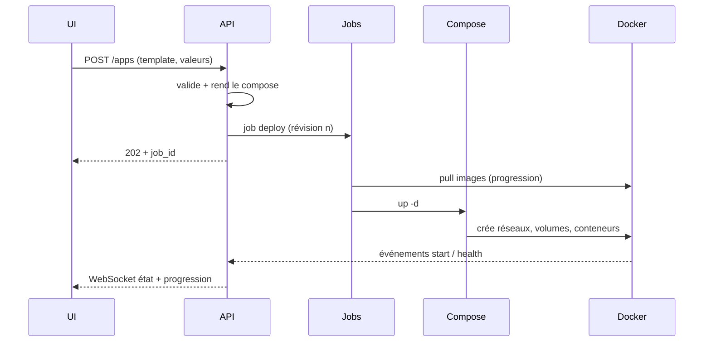
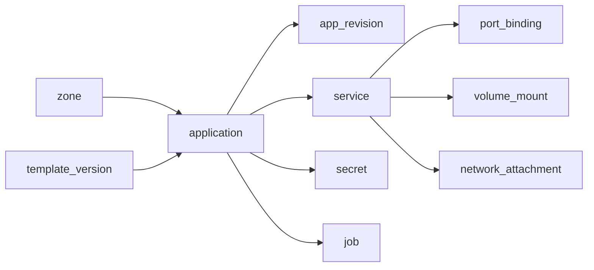
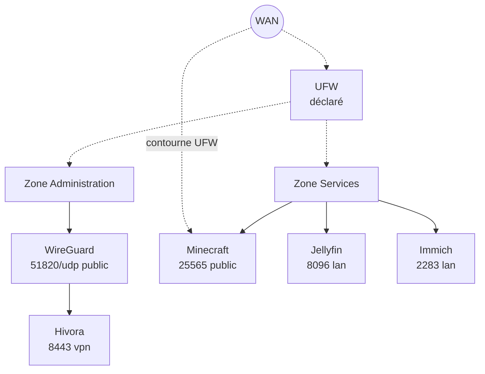

# Hivora — Vision, PRD & Architecture

*23 septembre 2026*

## Synthèse et décisions challengées

Hivora est viable en V1 sous la forme d'un conteneur unique (FastAPI + frontend statique + SQLite) qui pilote Docker via le socket, avec un budget cible de < 150 Mo de RAM au repos. La vision est cohérente ; six décisions méritent d'être ajustées pour la tenir.

| # | Décision initiale | Challenge | Recommandation |
|---|---|---|---|
| 1 | Next.js | Un serveur Next.js (SSR) ajoute un process Node de 100 à 200 Mo, contraire au principe de légèreté. | Garder Next.js, mais en export statique (`output: export`) servi par FastAPI. Aucun runtime Node en production. |
| 2 | Topologie « WAN → UFW → Zone » | Docker contourne UFW : un port publié (`-p`) écrit ses règles iptables avant celles d'UFW. Afficher UFW comme protection serait faux. | La topologie distingue l'observé (Docker) du déclaré (utilisateur), et signale explicitement les ports exposés hors pare-feu. Intégration réelle via la chaîne `DOCKER-USER` en V3. |
| 3 | Images OVH Game Panel | Elles sont conçues pour l'orchestrateur OVH : conventions d'entrypoint, variables et chemins non documentés publiquement, licence et pérennité non garanties. | Les utiliser via des templates Hivora qui encapsulent l'image. Si une image disparaît ou casse, seul le template change. Prévoir une image de repli communautaire par jeu. |
| 4 | Pas de compose comme format principal | Juste, mais l'écosystème self-hosted vit en docker-compose. Refuser l'import serait un frein majeur à l'adoption. | Format Hivora comme source de vérité, compose comme artefact généré, et import compose dès la V2. |
| 5 | Pas de reverse proxy mentionné | Domaines + HTTPS sont le besoin n°1 des auto-hébergeurs après le déploiement. | Ajouter un « proxy managé » optionnel (Caddy) en V2, activable par application. |
| 6 | Accès au socket Docker | Accès au socket = accès root sur l'hôte. Hivora devient la cible la plus sensible du serveur. | Panel non exposé par défaut, TOTP fortement poussé à l'installation, WireGuard proposé, rate limiting et journal d'audit dès la V1. |

**Principe d'arbitrage retenu pour tout le document** : Docker est la source de vérité de l'état réel, SQLite est la source de vérité de l'intention. Hivora réconcilie les deux et montre toujours l'écart.

---

## 1. Vision produit

Hivora est le panneau de contrôle Docker qu'on installe en une commande, qu'on comprend en une minute et qu'on ne quitte pas quand on devient expert.

### Le problème

- **CasaOS / Umbrel** : simples, mais opaques. Dès qu'on veut changer un réseau ou un volume, on sort de l'outil.
- **Portainer** : puissant, mais pensé pour des opérateurs. Le vocabulaire (endpoints, stacks, services Swarm) décourage les débutants.
- **Panels de jeux (OVH, Pterodactyl, AMP)** : excellents pour les jeux, inutiles pour le reste du homelab, et souvent lourds (Pterodactyl = PHP + MySQL + Redis + daemon Wings).

Un homelabber finit avec trois outils pour un seul serveur.

### La réponse Hivora

Un seul outil, trois niveaux de lecture de la même réalité :

1. **Vue Applications** : des tuiles, un état, des boutons. Le débutant s'arrête là.
2. **Vue Avancée** : variables, ports, volumes, réseaux, logs, console, compose généré. L'expert y passe son temps.
3. **Vue Topologique** : l'infrastructure comme un schéma, pour comprendre et documenter.

Chaque niveau montre la même chose, de plus en plus en détail. Rien n'est caché, tout est progressivement révélé.

### Personas

| Persona | Profil | Ce qu'il attend | Moment « waouh » |
|---|---|---|---|
| Léa, gameuse | Loue un VPS, ne connaît pas Docker | Un serveur Palworld pour ses amis ce soir | Serveur en ligne en moins de 3 minutes, adresse copiable |
| Karim, homelabber | Mini PC, 15 conteneurs, connaît compose | Voir et organiser son infra, mettre à jour sans stress | Sa stack existante importée, rangée en zones, visible en topologie |
| Julien, admin | Serveur dédié, exigeant sur la sécurité | Contrôle total, rien de magique | Le compose généré est lisible, modifiable, et Hivora respecte ses réseaux |

### Principes produit

1. **Simple par défaut, avancé quand nécessaire** : chaque écran a un mode simple ; le mode avancé est à un clic, jamais caché.
2. **Transparence radicale** : toute action affiche ce qu'elle fait sur Docker (commande ou compose équivalent).
3. **Pas d'enfermement** : désinstaller Hivora laisse des conteneurs et des fichiers compose parfaitement fonctionnels.
4. **Docker natif** : Hivora n'invente pas de runtime ; il écrit des labels `io.hivora.*` et des fichiers compose standard.
5. **Frugalité mesurée** : un budget de ressources publié et vérifié en CI à chaque release.

### Indicateurs de succès

| Indicateur | Cible V1 |
|---|---|
| Temps install → première app en ligne | < 5 min sur un VPS neuf |
| RAM de Hivora au repos (10 apps) | < 150 Mo |
| Clics pour déployer un template sans option | ≤ 3 |
| Taille de l'image Docker Hivora | < 200 Mo |

---

## 2. PRD

La V1 couvre le cycle complet d'une application sur un hôte unique : installer, déployer, organiser en zones, opérer, comprendre. Sauvegardes, mises à jour automatiques et reverse proxy arrivent en V2.

### Périmètre V1

**Dans le périmètre** : installation en une commande, comptes utilisateurs avec rôles simples (admin, opérateur, lecture) + TOTP, catalogue de templates officiels, déploiement d'image libre, stacks multi-conteneurs, zones, modes simple/avancé, logs, console, compose généré, topologie en lecture, métriques de base, journal d'audit.

**Hors périmètre V1** : multi-hôtes, sauvegardes planifiées, reverse proxy managé, import compose, gestion du pare-feu, marketplace communautaire.

### Exigences fonctionnelles

| ID | Domaine | Exigence | Priorité |
|---|---|---|---|
| F-01 | Installation | Script `get.hivora.io` : détecte l'OS, installe Docker si absent, lance Hivora, affiche l'URL et rappelle les identifiants initiaux à changer | Must |
| F-02 | Installation | Premier lancement : compte `admin` / `admin` créé automatiquement, changement de mot de passe **obligatoire** à la première connexion (aucune autre action possible avant), puis TOTP (recommandé, skippable), fuseau, dossier de données | Must |
| F-03 | Auth | Argon2id (sel par utilisateur), sessions en cookie HttpOnly, TOTP RFC 6238, 10 codes de récupération | Must |
| F-25 | Utilisateurs | Gestion des comptes depuis l'interface (admin) : créer, modifier, désactiver, supprimer, réinitialiser mot de passe et TOTP, révoquer les sessions. Rôles : admin (tout), opérateur (piloter et déployer les apps, pas les comptes ni la configuration), lecture seule. Impossible de supprimer, désactiver ou rétrograder le dernier admin actif | Must |
| F-04 | Auth | Limitation des tentatives (5 échecs → délai exponentiel), journalisation des connexions | Must |
| F-05 | Catalogue | Parcourir, filtrer par catégorie (Jeux, Médias, Productivité…), voir la fiche d'un template | Must |
| F-06 | Déploiement | Déployer un template via un formulaire généré, avec valeurs par défaut sûres | Must |
| F-07 | Déploiement | Déployer une image libre (Docker Hub, GHCR, Quay, registre privé avec identifiants) | Must |
| F-08 | Déploiement | Aperçu du compose généré avant validation, modifiable en mode avancé | Must |
| F-09 | Déploiement | Détection des conflits de ports avant déploiement, avec suggestion de port libre | Must |
| F-10 | Applications | Démarrer, arrêter, redémarrer, supprimer (avec choix : garder ou supprimer les données) | Must |
| F-11 | Applications | État agrégé d'une stack (Sain, Démarrage, Dégradé, Arrêté, En erreur, Absent) à partir de l'état de chaque conteneur et des healthchecks | Must |
| F-12 | Avancé | Éditer variables, ports, volumes, réseaux, labels, politique de redémarrage, limites CPU/RAM | Must |
| F-13 | Avancé | Logs en temps réel par conteneur et agrégés par application, recherche, téléchargement | Must |
| F-14 | Avancé | Console web (exec `sh` / `bash`) dans un conteneur | Must |
| F-15 | Zones | Créer, renommer, colorer, supprimer des zones ; y ranger des applications | Must |
| F-16 | Zones | Option par zone : réseau Docker dédié (isolé ou non) | Should |
| F-17 | Découverte | Détecter les conteneurs existants non gérés et proposer de les « adopter » (liaison par projet compose, sans redéploiement ; conversion en app Hivora optionnelle) | Should |
| F-18 | Topologie | Vue topologique en lecture : zones, apps, réseaux, ports exposés, nœuds déclarés (WAN, WireGuard…) | Should |
| F-19 | Monitoring | CPU, RAM, réseau, disque de l'hôte et par application, historique 24 h | Should |
| F-20 | Mises à jour | Détecter qu'une nouvelle image est disponible (digest), mise à jour manuelle en un clic | Should |
| F-21 | Jeux | Fiche jeu : adresse de connexion copiable, joueurs max, version, lien vers la console | Should |
| F-22 | Audit | Journal de toutes les actions (qui, quoi, quand, résultat) | Must |
| F-23 | Système | Version installée et disponible (GitHub Releases), notes de version, commande de mise à jour ; bouton « Mettre à jour » en M13 (voir « Distribution et versions ») | Could |
| F-24 | Console | Accès rapide à la console : ouverture en un clic depuis la tuile d'app, le détail, la topologie ou ⌘K, dans un tiroir persistant multi-onglets, sans quitter l'écran courant | Must |

### Parcours clés

**Parcours 1 — Léa déploie Palworld**

1. Catalogue → tuile Palworld → « Déployer ».
2. Formulaire : nom du serveur, mot de passe, joueurs max. Zone proposée : Gaming.
3. Clic « Déployer ». Écran de progression : pull de l'image (barre %), création, démarrage.
4. Fin : carte avec l'adresse `IP:8211` copiable et un rappel si le port n'est pas ouvert sur le routeur.

**Parcours 2 — Karim adopte ses conteneurs**

1. Premier lancement : « 14 conteneurs détectés, 3 projets compose ».
2. Hivora regroupe par label `com.docker.compose.project` et propose une app par projet.
3. Karim assigne chaque app à une zone. Rien n'est redéployé : seules des métadonnées Hivora sont créées.
4. Les apps adoptées sont reliées par `com.docker.compose.project`. Leur révision 0 est une copie de `docker compose config` si le fichier est accessible ; sinon l'app n'est pas modifiable (démarrer, arrêter, logs et console seulement). « Convertir en app Hivora » recrée la stack avec les labels `io.hivora.*`, après avoir montré le diff.

**Parcours 3 — Julien modifie un réseau**

1. App Nextcloud → Avancé → Réseaux.
2. Il retire le réseau par défaut et attache `backend_net`.
3. Hivora affiche le diff du compose, puis applique. L'opération est journalisée.

### Exigences non fonctionnelles

| Catégorie | Exigence |
|---|---|
| Ressources | < 150 Mo RAM au repos, < 2 % CPU au repos sur un cœur, image < 200 Mo |
| Plateformes | Linux amd64 et arm64 (Raspberry Pi 4/5), Debian, Ubuntu, Fedora, Rocky |
| Docker | Docker Engine ≥ 24 avec plugin Compose v2 |
| Performance | Tableau de bord affiché en < 1 s pour 50 apps ; état mis à jour en < 2 s après un événement Docker |
| Sécurité | HTTPS par défaut (certificat auto-signé à défaut de domaine), CSRF, en-têtes de sécurité, secrets chiffrés au repos |
| Réversibilité | Toute app reste pilotable par `docker compose` sans Hivora |
| Accessibilité | Navigation clavier, contrastes WCAG AA, mode sombre et clair |
| i18n | Français et anglais en V1, clés de traduction dès le départ |

### Hypothèses à valider

- Les images `ovhcom/gamepanel-*` sont utilisables hors infrastructure OVH sans agent propriétaire.
- Le plugin Compose v2 est acceptable comme dépendance (plutôt que réimplémenter l'orchestration de stack).
- Les utilisateurs acceptent un certificat auto-signé au premier accès.

---

## 3. Architecture technique

Hivora tourne dans un seul conteneur : un process Python (FastAPI sous Uvicorn) qui sert l'API, le WebSocket et le frontend statique, et qui pilote Docker via le socket monté. Aucun Node, Redis ou PostgreSQL en production.



Le navigateur ne parle qu'à Hivora ; Hivora écrit l'intention en SQLite, génère le compose sur disque, l'applique via Compose v2, puis écoute les événements Docker pour refléter l'état réel.

### Choix structurants

| Sujet | Choix | Justification |
|---|---|---|
| Frontend | Next.js en export statique, servi par FastAPI | Pas de runtime Node ; SPA avec routage client ; build embarqué dans l'image |
| API | FastAPI + Pydantic v2, REST + WebSocket | Validation typée, OpenAPI généré gratuitement (base de l'API publique future) |
| Client Docker | `aiodocker` (async) pour lecture, événements, logs, exec, stats | Non bloquant ; le SDK officiel est synchrone |
| Orchestration de stack | `docker compose` v2 appelé en subprocess sur des fichiers générés | Compose gère dépendances, recréation, diff ; le compose généré est exactement ce qui tourne |
| Base | SQLite en mode WAL, SQLAlchemy 2 + Alembic | Un fichier, migrations versionnées, sauvegarde triviale |
| Tâches de fond | File de jobs persistée en SQLite + workers asyncio in-process | Pas de Redis ; jobs reprenables après redémarrage |
| Temps réel | Un WebSocket multiplexé (événements, logs, progression, console) | Une seule connexion par onglet |
| Métriques | Échantillonnage stats toutes les 10 s (one-shot, pas de streams permanents), agrégats 1 min / 5 min en SQLite, rétention 24 h puis 7 j | Les streams stats permanents coûtent cher avec 50 conteneurs |
| Secrets | Chiffrement AES-GCM, sous-clé HKDF par usage, dérivée d'une clé maître dans `/opt/hivora/data/secret.key` (0600). Le compose généré référence `${HV_SECRET_*}` ; les valeurs sont écrites dans `apps/<slug>/.env` (0600), lu nativement par Compose | Mots de passe d'apps et identifiants de registre jamais en clair en base ni dans le compose ; la stack reste utilisable sans Hivora |

### Arborescence des données

| Chemin | Contenu |
|---|---|
| `/opt/hivora/data/hivora.db` | Base SQLite |
| `/opt/hivora/data/secret.key` | Clé maître de chiffrement |
| `/opt/hivora/data/apps/<app_slug>/compose.yaml` | Compose généré, lisible et utilisable sans Hivora |
| `/opt/hivora/data/apps/<app_slug>/hivora.yaml` | Instance de template + valeurs saisies (hors secrets) |
| `/opt/hivora/data/templates/<source>/` | Cache des dépôts de templates |
| `/opt/hivora/data/apps/<app_slug>/.env` | Valeurs des secrets de l'app (0600), jamais versionnées ni journalisées |
| `/srv/hivora/<app_slug>/<volume>/` (hôte, configurable) | Volumes des templates, montés en bind (créés avec PUID/PGID), séparés des données Hivora ; monté à l'identique dans le conteneur Hivora |

### Montages du conteneur Hivora

Trois montages seulement : `/var/run/docker.sock`, `/opt/hivora/data` et `/srv/hivora`, chacun au **même chemin** que sur l'hôte. Le compose généré contient des chemins hôte absolus, donc valides qu'on le lance depuis Hivora ou directement sur l'hôte. Hivora crée lui-même les dossiers des volumes avec le bon PUID/PGID.

### Réconciliation intention / réalité

1. Chaque conteneur créé par Hivora porte `io.hivora.app`, `io.hivora.zone`, `io.hivora.revision`. Les apps adoptées non converties sont reliées par `com.docker.compose.project`.
2. Au démarrage, Hivora liste tous les conteneurs et construit l'état réel.
3. Il s'abonne ensuite au flux `/events` et met à jour l'état en mémoire, puis le pousse au frontend.
4. Tout écart (conteneur supprimé à la main, label modifié, image changée) est affiché comme dérive, avec deux actions : « réappliquer Hivora » ou « accepter l'état réel ».

### Déploiement d'une application (séquence)



Toute modification produit une nouvelle révision : on peut comparer deux révisions et revenir à la précédente.

### Sécurité

- **Exposition par défaut** : port 8443 en HTTPS auto-signé, publié sur l'IP LAN seulement, et panel joignable par le VPN d'administration (mode « VPN + LAN », voir « Installation »). Le mode public n'est jamais un défaut.
- **WireGuard** : app système gérée par le module `vpn` (`linuxserver/wireguard`), dans la zone Administration, jamais imposée aux autres apps. Elle porte l'accès d'administration au panel (voir « VPN d'administration »).
- Cookies `Secure`, `HttpOnly`, `SameSite=Strict` ; jeton CSRF ; session expirée après 12 h d'inactivité.
- Console et exec derrière une re-confirmation TOTP si activé, valable 15 min pour toutes les consoles : la sécurité ne casse pas l'accès rapide. **En mode d'accès public, le TOTP est obligatoire** : sans TOTP actif, la session n'autorise que sa configuration (comme le changement de mot de passe initial) : page `/setup-totp/`, puis le panel dans la même session ; il ne peut pas être désactivé ; récupération par codes de secours, par un autre admin ou par `python -m hivora reset-totp` sur la machine.
- Le conteneur Hivora s'exécute sans `privileged` ; il ne monte que le socket, `/opt/hivora/data` et `/srv/hivora`.

### Installation (décisions du 14/10/2026, M12)

Commande officielle, sans domaine ni service tiers : le script est un fichier de chaque GitHub Release, publié avec sa somme SHA-256.

```
curl -fsSL https://github.com/hiidenops/hivora/releases/latest/download/install.sh | sudo sh
```

0. **Écrans** (M12-5c, seulement dans un terminal, jamais avec `--yes`) : langue (Français / English) ; mode d'accès en quatre choix pratiques (« Réseau local uniquement », « Réseau local + VPN », « Uniquement par le VPN », « Internet (avancé) »), avec la machine détectée et le défaut (VPN + LAN sur IP privée, VPN seul sans réseau privé ; sans IP privée, les deux premiers sont indisponibles sauf `--bind`) ; en mode VPN, adresse publique détectée (`api.ipify.org`) à confirmer ou à remplacer par une IP ou un nom DNS (nom qui ne se résout pas : avertissement) ; mot à taper pour « VPN seul » et « Internet » ; récapitulatif. Une relance ne pose aucune question (mode et langue repris d'`install.env`) ; `--reconfigure` repose le menu (mode actuel présélectionné, avertissements de transition).
1. Vérifie OS, distribution, architecture (amd64, arm64), droits root ; affiche ce qu'il va faire et demande confirmation (`--yes` pour l'automatisation, `--dry-run` pour seulement afficher les commandes). Tout le script est une fonction appelée à la dernière ligne : un téléchargement interrompu n'exécute rien.
2. Installe Docker par le script officiel (`get.docker.com`) si absent ; exige Docker Engine ≥ 24. Compose v2 n'est pas requis sur l'hôte : l'image Hivora embarque son propre binaire.
3. Détecte IP LAN, fuseau, PUID/PGID, ports libres (8443/tcp, 51820/udp).
4. Écrit `/opt/hivora/data/install.env` (0600) : **source de vérité des options de lancement** du conteneur (version exacte, image, mode d'accès, port, adresses, PUID/PGID, fuseau). Relancer le script le relit : c'est ainsi qu'on met à jour ou qu'on change de mode.
5. Sauvegarde le panel avant toute mise à jour (`hivora.db` par instantané cohérent, `secret.key`, `install.env`).
6. Lance le conteneur `hivora` (`restart: unless-stopped`), version exacte résolue à l'installation (jamais `latest` en dur), attend « healthy ».
7. Initialise par `python -m hivora bootstrap` **dans le conteneur** : le script ne touche jamais la base ni les fichiers WireGuard ; le bootstrap construit les vrais services (migrations, secrets chiffrés, jobs), est idempotent et ne recrée rien qui existe.
8. Affiche d'abord le bloc « HIVORA EST PRÊT » : URL, identifiant `admin` et son **mot de passe aléatoire** (à changer à la première connexion, comme avant) ; ensuite seulement le VPN : rien en mode réseau local (rappel de `--reconfigure`) ; en VPN + LAN, VPN disponible ou en préparation, sans attente ni QR code (`admin.conf` et la commande `python -m hivora admin-vpn`) ; en VPN seul, attente du VPN, procédure pas à pas et QR code en dernier.

Pas de PostgreSQL ni de composant séparé : une seule image sert l'API, le WebSocket et le frontend statique, sur SQLite. Le lancement manuel (`deploy/compose.yaml`) garde le compte initial `admin` / `admin`, changement obligatoire.

**Distributions officiellement supportées** : Debian 12 et plus, Ubuntu 22.04 et plus, Raspberry Pi OS 64 bits. Les autres Linux amd64/arm64 avec Docker ≥ 24 fonctionnent « au mieux », avec un message clair ; Docker rootless et Podman sont refusés.

### VPN d'administration

Le panel est joignable par WireGuard sans publier son port sur l'hôte : le conteneur `hivora` rejoint le réseau Docker de la zone Administration, à une **IP fixe réservée** ; le serveur WireGuard (module `vpn`) donne accès à cette zone par le mécanisme « Zones accessibles » existant.

| Mode | Ports publiés sur l'hôte | Panel joignable depuis |
|---|---|---|
| **VPN + LAN** (défaut) | 51820/udp, `IP_LAN:8443` | clients VPN autorisés, réseau local |
| **VPN uniquement** | 51820/udp | clients VPN autorisés sur la zone Administration |
| **Public** | `0.0.0.0:8443` (+ 51820/udp) | partout ; alerte permanente, TOTP obligatoire |

- **Mise en conformité au démarrage du serveur** (M12-5a ; et non `bootstrap --vpn`, car le déploiement est un job et la file de jobs vit dans le processus du serveur) : en mode `vpn` ou `vpn+lan`, la zone Administration passe en réseau partagé, l'app WireGuard « Admin VPN » y est déployée (réseau du VPN `10.254.253.0/24`, port `HIVORA_ADMIN_VPN_PORT`, adresse des clients `HIVORA_ADMIN_VPN_HOST`, sinon l'adresse publique, sinon l'IP LAN), avec un client VPN `admin` (zone Administration seulement, ni Internet ni LAN), et `/opt/hivora/data/admin.conf` (0600, réécrit quand ses clés changent) ; le réglage `vpn.admin` garde ce qui a été créé : rien n'est créé deux fois. `python -m hivora admin-vpn` affiche le fichier et son QR code dans le terminal. Adressage fixe partagé avec l'installeur (M12-5b) : réseau de la zone `10.254.254.0/24`, plage donnée par Docker `10.254.254.0/25`, panel `10.254.254.254`.
- Le mode d'accès est un réglage de lancement : il vit dans `install.env`, le panel l'affiche en lecture seule avec la commande pour le changer (`install.sh --access vpn|lan|public`). Hivora ne recrée jamais son propre conteneur (jusqu'à M13).
- **Installeur** (M12-5b) : `--access vpn+lan` (défaut d'une nouvelle installation ; une installation existante garde son mode) ou `vpn` ; avant tout changement, il vérifie le port UDP (libre, ou déjà celui de l'app `admin-vpn`), qu'aucune adresse ou route de l'hôte ne tombe dans `10.254.254.0/24` ou `10.254.253.0/24`, et que le réseau `hivora-zone-administration`, s'il existe, a bien la plage `10.254.254.0/24` (sinon refus, avec la marche à suivre) ; il crée ce réseau (`--subnet 10.254.254.0/24 --ip-range 10.254.254.0/25`), lance le panel avec `--network hivora-zone-administration --ip 10.254.254.254` (et `-p IP_LAN:PORT:8443` en `vpn+lan`), attend `admin.conf` (10 min au plus, sinon un avertissement) et affiche son QR code à la création. `--vpn-host`, `--vpn-port` gardés dans `install.env` ; `--rescue-admin` : `rescue-admin`, redémarrage du conteneur, nouveau QR code. Le certificat auto-signé créé en mode VPN porte aussi `10.254.254.254`.
- **Adresse et port du VPN d'administration** (M12-5d, D17) : `install.env` fait foi quand il les fixe (l'installeur passe `HIVORA_ADMIN_VPN_HOST` s'il est connu et toujours `HIVORA_ADMIN_VPN_PORT`). À chaque démarrage, s'ils diffèrent des réglages de l'app « Admin VPN », une nouvelle révision les applique (job attendu ; port déjà pris : erreur journalisée, ancien port gardé) ; les clés ne changent pas, seule la ligne `Endpoint` des configurations : `admin.conf` est réécrit, les appareils corrigent « Endpoint » ou réimportent. Toute nouvelle révision recrée le conteneur WireGuard (étiquette `io.hivora.revision` du compose) : courte coupure, que l'adresse ou le port change. Le panel refuse de modifier une valeur fixée (`409 admin_vpn_managed`). L'installeur lit l'ancien point d'accès dans `admin.conf`, avertit (« ancienne → nouvelle », coupure de quelques secondes), propose l'adresse actuelle en `--reconfigure`, n'accepte un port UDP occupé que s'il est publié par l'app `admin-vpn`, et en VPN seul attend le nouvel `admin.conf` avant d'afficher le QR code.
- Contre l'enfermement : dans les deux modes VPN, supprimer l'app « Admin VPN », supprimer ou désactiver (ou faire expirer) son client `admin` est refusé (`409 admin_vpn_protected`) ; porte de secours locale `install.sh --access lan` ; `python -m hivora rescue-admin` donne de nouvelles clés au client `admin` (réactivé, sans expiration) au démarrage suivant, et l'ancien `admin.conf` ne fonctionne plus.

### Santé et page Système (M12-6)

- `GET /system/status` (admin, lecture seule) : `version`, `database` (schéma, taille, WAL ; `PRAGMA quick_check` seulement avec `deep=true`), `disk` (données du panel et volumes : avertissement sous 10 % **et** 20 Go libres, erreur sous 3 % **ou** 500 Mo), `docker`, `jobs` (échec en 24 h ou tâche en cours depuis plus d'une heure : avertissement), `panel_backup`, `exposure` (où le conteneur `hivora` publie son port : toutes les adresses hors mode public = erreur, mode public = rappel), `tls` (expiration à moins de 30 jours), `admin_vpn` (modes VPN). Carte « Santé du panel » dans Paramètres avec le mode d'accès actuel et « Vérifier la base » ; pastille sur « Paramètres » ; bandeaux d'exposition pour les admins.
- **Code source** (AGPL-3.0 §13) : lien sur la page de connexion et dans Paramètres, vers `…/tree/v<version>` pour une release (sinon le dépôt) ; `HIVORA_SOURCE_URL` pour une version modifiée.
- **Version du frontend** lue au build (`package.json`) : différente de celle du serveur → « rechargez la page ».

### Distribution et versions

- **Licence** : AGPL-3.0 (`LICENSE` à la racine).
- **Source de vérité de la version** : le tag git `vX.Y.Z` (SemVer ; avant 1.0, une mineure peut casser, la release le dit). La CI refuse un tag différent de la version du paquet Python. L'image porte les labels OCI `version` et `revision` ; le frontend embarque la version de son build.
- **Version disponible** : GitHub Releases du dépôt, seule source. Canaux `stable` (défaut) et `pre` (`vX.Y.Z-rc.N`). Vérification activée par défaut, désactivable, au plus toutes les 12 h, cache en mémoire, aucune donnée envoyée hors `User-Agent: Hivora/<version>`, échec silencieux hors ligne.
- **Changelog** : `CHANGELOG.md` (format Keep a Changelog, en français), section du tag reprise comme corps de la release (la CI échoue si elle manque), embarqué dans l'image pour les notes de la version installée. Les notes distantes sont affichées assainies (texte, aucun contenu tiers chargé).
- **Images** : `ghcr.io/hiidenops/hivora`, tags `vX.Y.Z`, `X.Y`, `latest` (stable seulement) ; digest publié dans la release.
- **Migrations** : additives d'une mineure à l'autre ; une base plus récente que le code est refusée au démarrage.
- **Mise à jour (M12)** : détection et affichage (version, notes, commande `install.sh` à copier) ; la mise à jour elle-même est la relance du script (sauvegarde du panel, nouvelle image, mêmes options).
- **Bouton « Mettre à jour » (M13)** : conteneur éphémère `hivora-updater` de la même image, lancé par `docker_gateway`, qui télécharge, vérifie le digest, recrée `hivora` depuis `install.env`, attend « healthy » et revient à l'image précédente sinon ; job `self_update` terminé par le nouveau processus. Exception de sécurité (Hivora recrée son propre conteneur) à valider avant M13.

---

## 4. Roadmap V1 → V5

Chaque version ajoute une couche sans alourdir la précédente : V1 déploie, V2 fiabilise, V3 sécurise le réseau, V4 passe à plusieurs serveurs, V5 ouvre l'écosystème.

| Version | Thème | Contenu principal | Critère de sortie |
|---|---|---|---|
| V0.x (alpha) | Socle | Auth, client Docker, compose génératif, 5 templates, UI Applications | Déployer Minecraft et Vaultwarden de bout en bout |
| V1 | Déployer et comprendre | Tout le périmètre Must/Should du PRD, 20 templates officiels (10 jeux, 10 services), zones, topologie en lecture, adoption de conteneurs existants | Budget RAM tenu, 3 parcours clés < 5 min, zéro perte de données en tests de suppression |
| V2 | Vivre avec ses apps | Sauvegardes (volumes + base, locales et S3/SFTP), restauration, mises à jour planifiées avec rollback, import docker-compose, reverse proxy managé (Caddy, HTTPS Let's Encrypt), notifications (e-mail, Discord, ntfy, webhook), outils jeux (RCON, joueurs connectés, planning de redémarrage) | Un utilisateur restaure une app sur un hôte vierge |
| V3 | Maîtriser le réseau | Topologie éditable (créer réseaux, attacher, déclarer des passerelles), règles d'exposition via `DOCKER-USER`, politiques d'isolation entre zones, WireGuard managé (pairs, QR codes), audit de sécurité (ports ouverts, images obsolètes, conteneurs root) | La topologie reflète 100 % des flux réellement ouverts |
| V4 | Plusieurs serveurs | Agent Hivora léger (Python ou Go, < 30 Mo) sur chaque hôte, connexion sortante vers le panel, zones multi-hôtes, déplacement d'app entre hôtes via sauvegarde/restauration, droits par zone (les rôles simples existent dès la V1) | 5 hôtes pilotés depuis un panel sur un Raspberry Pi |
| V5 | Écosystème | Catalogues communautaires signés, SDK de templates + validateur CLI, API publique stable et jetons, OIDC/SSO, plugins UI (onglets additionnels), mode « infra as code » (export/import de tout l'état Hivora en YAML) | Premier catalogue tiers avec > 100 templates |

### Ce qui ne sera pas fait

VM, LXC, Kubernetes et Swarm restent hors de la trajectoire. Si le besoin multi-hôtes grandit, la réponse est l'agent V4, pas un orchestrateur.

---

## 5. Modèle de données

SQLite ne stocke que l'intention et l'historique ; l'état d'exécution (conteneur up/down, CPU) vit en mémoire, alimenté par Docker. Cette séparation évite la désynchronisation et garde la base petite.



Une zone contient des applications ; une application naît d'une version de template (ou d'une image libre), possède des révisions et des services (conteneurs), chacun avec ses ports, volumes et réseaux.

### Tables

| Table | Colonnes clés | Rôle |
|---|---|---|
| `user` | id, username, password_hash (argon2id, sel inclus), role (admin, operator, viewer), must_change_password, disabled, totp_secret (chiffré), totp_enabled, recovery_codes (hachés), created_at, last_login_at | Comptes et rôles |
| `session` | id, user_id, token_hash, csrf_token, ip, user_agent, created_at, last_seen_at, expires_at | Sessions révocables |
| `setting` | key, value (JSON) | Paramètres globaux (ports, domaine, dossier de volumes, langue) |
| `zone` | id, slug, name, color, icon, description, network_mode (none, shared, isolated, custom), docker_network_id, sort_order, is_system | Zones logiques |
| `template_source` | id, name, url, kind (official, git, https), trust_key, last_sync_at, enabled | Dépôts de templates |
| `template` | id, source_id, slug, name, category, icon, tags | Entrée du catalogue |
| `template_version` | id, template_id, version, api_version, manifest (YAML brut), checksum, published_at | Versions immuables |
| `application` | id, slug, name, zone_id, origin (template, image, adopted, compose), template_version_id, current_revision_id, desired_state (running, stopped), icon, notes, created_at | L'unité manipulée par l'utilisateur |
| `app_revision` | id, app_id, number, inputs (JSON, secrets exclus), compose_yaml, diff_from_previous, created_by, created_at, applied_at, status | Historique et rollback |
| `service` | id, app_id, name, image, image_digest, role (main, database, cache, sidecar), restart_policy, cpu_limit, mem_limit | Un conteneur logique de la stack |
| `port_binding` | id, service_id, host_ip, host_port, container_port, protocol, purpose (web, game, rcon, query), exposure (public, lan, vpn, internal) | Base de la topologie et de la détection de conflits |
| `volume_mount` | id, service_id, kind (named, bind), source, target, read_only, backup (bool) | Données persistantes |
| `network` | id, docker_id, name, driver, subnet, internal, managed_by (hivora, user, docker) | Réseaux connus |
| `network_attachment` | service_id, network_id, aliases | Liens service ↔ réseau |
| `secret` | id, app_id, key, ciphertext, nonce | Valeurs sensibles des formulaires |
| `registry_credential` | id, registry, username, ciphertext | Registres privés |
| `job` | id, kind (deploy, update, remove, pull, start, stop, restart, rollback, adopt, convert, move_zone, backup en V2), app_id, status, progress, log, started_at, finished_at, error | File de tâches persistée |
| `topology_node` | id, kind (wan, firewall, vpn, gateway, router, note), label, position (JSON), properties | Nœuds déclarés par l'utilisateur |
| `topology_edge` | id, source_ref, target_ref, label, kind (declared) | Liens déclarés |
| `topology_layout` | ref (zone:x, app:y, node:z), x, y, collapsed | Positions mémorisées sur le canevas |
| `metric_sample` | ts, scope (host, app), ref, cpu, mem, net_rx, net_tx, disk | Agrégats 1 min / 5 min, purge automatique |
| `audit_log` | id, ts, user_id, username, ip, action, target, payload (résumé), result | Traçabilité |
| `backup_policy` / `backup_run` | (V2) planning, destination, rétention / statut, taille, emplacement | Sauvegardes |

### Règles

- Les identifiants Docker (container id) ne sont jamais clés primaires : on relie par labels `io.hivora.*`, stables entre recréations (ou `com.docker.compose.project` pour les apps adoptées non converties).
- `app_revision.compose_yaml` est l'artefact exact appliqué ; le fichier sur disque en est une copie.
- Pour une app adoptée, la révision 0 est une copie de `docker compose config` (si le fichier compose est accessible) ; elle n'a jamais été appliquée par Hivora.
- Les secrets n'apparaissent ni dans `inputs`, ni dans les logs de job, ni dans l'audit : ils sont référencés par clé.
- Volume de base visé : < 50 Mo après un an d'usage, grâce à la purge des métriques et des logs de jobs (> 30 j).

---

## 6. Modules backend

Le backend est un monolithe modulaire : 16 modules V1 à frontières nettes, dépendant tous d'un noyau commun, sans microservices. Les routes HTTP sont fines ; la logique vit dans des services testables sans Docker réel.

| Module | Responsabilité | Dépend de | Version |
|---|---|---|---|
| `core` | Config, logging structuré, erreurs, bus d'événements interne (pub/sub asyncio), horloge | — | V1 |
| `db` | Moteur SQLite (WAL), sessions SQLAlchemy, migrations Alembic, purge périodique | core | V1 |
| `crypto` | Argon2id, TOTP, chiffrement AES-GCM des secrets, gestion de la clé maître | core | V1 |
| `auth` | Compte initial, login, TOTP, codes de récupération, sessions, rate limiting, CSRF, utilisateurs et rôles | db, crypto | V1 |
| `docker_gateway` | Unique point d'accès au socket : conteneurs, images, réseaux, volumes, exec, logs, stats, événements. Seule exception : le CLI `docker compose` lancé par `compose_runner` | core | V1 |
| `compose_runner` | Écrit les fichiers, appelle `docker compose` (up, down, pull, config), parse la progression, verrou par app. Seul module autorisé à lancer `docker compose`, qui accède au socket | docker_gateway | V1 |
| `state` | État réel en mémoire (conteneurs, santé, ports), abonnement aux événements Docker, calcul de l'état agrégé des apps et de la dérive | docker_gateway, db | V1 |
| `templates` | Synchronisation des sources, validation du schéma `hivora/v1`, rendu (formulaire → compose), vérification de signature | db, crypto | V1 |
| `apps` | Cycle de vie : créer, modifier, révisions, rollback, démarrer/arrêter, supprimer, adopter, affectation à une zone | templates, compose_runner, state, zones | V1 |
| `zones` | CRUD zones, réseaux Docker associés | db, docker_gateway | V1 |
| `jobs` | File persistée, workers asyncio (concurrence 2 par défaut), reprise au redémarrage, annulation | db, core | V1 |
| `realtime` | WebSocket multiplexé : canaux état, job, logs, console, métriques ; authentification par session | state, jobs | V1 |
| `metrics` | Échantillonnage hôte (psutil) et conteneurs, agrégation, rétention | docker_gateway, db | V1 |
| `topology` | Construit le graphe observé + déclaré, persiste les nœuds déclarés et positions | state, zones, db | V1 (lecture), V3 (édition) |
| `audit` | Écoute le bus d'événements et journalise les actions | db, core | V1 |
| `system` | Infos hôte, version, mise à jour d'Hivora (pull + recréation par un conteneur éphémère), diagnostics | docker_gateway | V1 |
| `updates` | Comparaison des digests distants, planification, rollback | apps, jobs | V2 |
| `backups` | Sauvegarde de volumes via conteneur éphémère (tar + zstd), base, destinations, restauration | apps, jobs | V2 |
| `proxy` | Pilotage d'un Caddy managé (routes, certificats) | apps, zones | V2 |
| `games` | Catalogue de modpacks (Modrinth, CurseForge), joueurs connectés, liste blanche et admins Minecraft (V1, avancé) ; requête Steam/A2S, planning de redémarrage, annonces avant arrêt | apps, docker_gateway | V1 (partiel) / V2 |
| `notify` | Canaux de notification et règles | core | V2 |
| `agent_hub` | Connexion et routage vers les agents distants | tous | V4 |

### Surface d'API (V1)

| Préfixe | Exemples de ressources |
|---|---|
| `/api/v1/auth` | login, logout, me, password, totp/enroll, totp/verify, totp/disable, sessions |
| `/api/v1/users` | CRUD comptes (admin), rôle, désactivation, réinitialisation mot de passe / TOTP, sessions |
| `/api/v1/apps` | liste, détail, déploiement, actions (start, stop, restart), revisions, rollback, adopt, compose, zone (`PUT /apps/{id}/zone`) |
| `/api/v1/apps/{id}/services` | variables, ports, volumes, réseaux, logs (téléchargement) |
| `/api/v1/zones` | CRUD, réseau |
| `/api/v1/templates` | catalogue, détail, schéma de formulaire, sources |
| `/api/v1/docker` | vue brute : conteneurs, images, réseaux, volumes (lecture + actions simples) |
| `/api/v1/topology` | graphe, nœuds déclarés, positions |
| `/api/v1/jobs`, `/api/v1/audit`, `/api/v1/metrics`, `/api/v1/system` | suivi et administration |
| `/ws` | WebSocket unique multiplexé |

### Règles d'implémentation

- Un verrou par application : jamais deux jobs concurrents sur la même stack.
- Toute action mutante passe par `jobs`, même courte : progression, reprise et audit homogènes.
- `docker_gateway` expose une interface abstraite : une implémentation locale (socket) en V1, une implémentation « agent distant » en V4, sans toucher aux autres modules.
- En V4, `compose_runner` s'exécute côté agent, au même titre que `docker_gateway`.

---

## 7. Modules frontend

Le frontend est une SPA Next.js exportée en statique, organisée par fonctionnalité, avec TanStack Query pour les données REST et un store léger alimenté par le WebSocket pour le temps réel. React Flow n'est chargé qu'à l'ouverture de la vue topologique.

### Écrans

| Route | Écran | Mode simple | Mode avancé |
|---|---|---|---|
| `/` | Tableau de bord | Zones en colonnes ou sections, tuiles d'apps avec état et actions rapides, santé de l'hôte | Filtres, recherche, vue liste dense |
| `/catalog` | Catalogue | Tuiles par catégorie, recherche | Sources de templates, version, manifeste brut |
| `/deploy/[template]` | Assistant de déploiement | Formulaire généré, zone suggérée | Onglet « Compose » éditable avant validation |
| `/deploy/image` | Image libre | Image + tag, port web, zone | Tout le spec : env, volumes, réseaux, limites, commande |
| `/apps/[id]` | Détail d'app | Statut, adresse d'accès, démarrer/arrêter/redémarrer, ressources | Onglets Services, Variables, Ports, Volumes, Réseaux, Logs, Console, Compose, Révisions |
| `/zones` | Zones | Créer, renommer, couleur, glisser des apps | Mode réseau de la zone, réseau Docker associé |
| `/topology` | Vue topologique | Schéma en lecture, zoom sur une zone | Nœuds déclarés, liens, export PNG/SVG |
| `/docker` | Docker brut | — | Conteneurs, images, réseaux, volumes, nettoyage (prune) |
| `/activity` | Activité | Jobs récents | Journal d'audit complet |
| `/settings` | Paramètres | Mot de passe, TOTP, langue, thème | Registres, sources de templates, exposition du panel, mise à jour |

### Découpage du code

| Module | Contenu |
|---|---|
| `app/` | Routes (App Router en export statique, segments dynamiques résolus côté client) |
| `features/apps` | Tuiles, détail, actions, onglets avancés |
| `features/deploy` | Moteur de formulaires générés depuis le schéma du template, prévisualisation compose |
| `features/zones` | Gestion et drag-and-drop des apps |
| `features/topology` | Canevas React Flow, nœuds personnalisés, auto-layout (ELK chargé à la demande) |
| `features/console` | Terminal xterm.js sur le canal WebSocket |
| `features/logs` | Visionneuse virtualisée (des milliers de lignes sans ralentir), recherche, pause |
| `lib/api` | Client typé généré depuis l'OpenAPI de FastAPI |
| `lib/realtime` | Connexion WebSocket unique, reconnexion, invalidation ciblée du cache TanStack Query |
| `components/ui` | shadcn/ui + composants Hivora (StatusBadge, PortChip, ZonePill, CodeView) |

### Principes d'interface

- Le bouton « Avancé » est un interrupteur global mémorisé, plus un lien local sur chaque écran. Jamais de fonctionnalité accessible uniquement en ligne de commande.
- Toute action destructive affiche ce qui sera supprimé (conteneurs, volumes, fichiers) avec une case « supprimer aussi les données » décochée par défaut.
- Optimistic UI pour démarrer/arrêter, corrigée par l'événement Docker réel.
- Typographie : Outfit pour l'interface, JetBrains Mono pour tout ce qui est technique (ports, images, variables, logs, compose), ce qui rend visible la frontière simple/avancé.
- Responsive : le tableau de bord et les actions d'app sont pleinement utilisables sur mobile ; la topologie et l'édition compose sont optimisées pour desktop.
- Palette de commandes (⌘K) : aller à une app, déployer, redémarrer. Très appréciée des profils avancés, invisible pour les débutants.
- Budget : bundle initial < 520 Ko gzip par page (250 Ko jusqu'au 28/09/2026) ; React Flow, xterm.js et l'éditeur de code (CodeMirror 6) chargés à la demande.

### Accès rapide à la console

La console s'ouvre en un clic depuis n'importe quel écran, dans un tiroir en bas de page qui reste ouvert pendant la navigation. On garde le tableau de bord, les logs ou la topologie sous les yeux tout en tapant des commandes.

| Point d'entrée | Geste | Ce qui s'ouvre |
|---|---|---|
| Tuile d'app (tableau de bord) | Icône Terminal au survol, toujours visible sur mobile | Console du service principal |
| Détail d'app | Bouton « Console » dans l'en-tête, à côté de Démarrer/Arrêter | Console du service principal, sélecteur des autres services |
| Vue topologique | Bouton dans le panneau latéral d'un nœud | Console du service cliqué |
| Palette de commandes | ⌘K puis « console immich » | Console de l'app choisie |
| Raccourci global | Ctrl + ² (AZERTY) ou Ctrl + backtick (QWERTY) | Ouvre ou replie le tiroir, dernier onglet actif |

**Comportement du tiroir**

- Plusieurs onglets simultanés (une console par service), renommés automatiquement `app › service`, couleur de la zone.
- Redimensionnable, repliable en barre fine, plein écran d'un double-clic ; état mémorisé entre les pages.
- Choix automatique du shell (`bash`, puis `sh`), modifiable ; utilisateur du conteneur par défaut, root en option avancée.
- Deux types de console, clairement étiquetés :
  - **Shell** : exec dans le conteneur (V1).
  - **Console serveur** : pour les jeux, entrée standard du process (attach) en V1, RCON en V2, pour taper `/say`, `/save` ou `/stop` directement.
- Si l'app est arrêtée, le bouton propose « Démarrer et ouvrir la console ».
- Copier/coller, recherche dans le tampon, historique conservé le temps de la session.

**Côté backend**

Le canal console du WebSocket multiplexé transporte chaque session exec (entrée, sortie, redimensionnement du terminal). Chaque ouverture est journalisée dans l'audit (app, service, utilisateur, durée), sans enregistrer les frappes. Plafond de 8 consoles simultanées et fermeture après 30 min d'inactivité, pour tenir le budget mémoire.

**Hors périmètre** : shell sur l'hôte lui-même, qui exigerait un conteneur Hivora privilégié et contredirait le modèle de sécurité.

---

## 8. Format des templates Hivora

Un template `hivora/v1` est un fichier YAML déclaratif qui décrit ce que l'utilisateur voit (métadonnées, formulaire) et ce que Docker exécute (services), puis se compile en un compose standard. Il ne contient aucune logique exécutable : pas de scripts, seulement des expressions de substitution limitées.

### Structure

| Bloc | Rôle | Obligatoire |
|---|---|---|
| `apiVersion`, `kind` | `hivora/v1`, `Template` | Oui |
| `metadata` | slug, nom, version du template, catégorie, tags, icône, description, liens (site, doc, source), mainteneur, licence de l'app | Oui |
| `requirements` | architectures supportées, RAM/CPU/disque minimum et recommandés, ports requis | Oui |
| `form` | Champs utilisateur groupés en sections `basic` et `advanced` | Non |
| `services` | Un ou plusieurs services : image, tag, rôle, env, ports, volumes, healthcheck, dépendances | Oui |
| `access` | Comment l'utilisateur accède à l'app : URL web, adresse de jeu, identifiants initiaux à afficher | Non |
| `backup` | Volumes à sauvegarder, commandes de pré/post sauvegarde déclaratives (ex. dump de base), mise en pause requise | Non |
| `update` | Stratégie (manuelle, auto-patch, auto-minor), tags suivis, notes de migration, versions bloquantes | Non |
| `game` | Protocole de requête (A2S, Minecraft), port RCON, joueurs max, commande d'arrêt propre | Non |
| `defaults` | Zone suggérée, politique de redémarrage, limites de ressources | Non |

### Exemple (Palworld, abrégé)

```yaml
apiVersion: hivora/v1
kind: Template
metadata:
  slug: palworld
  name: Palworld
  version: 1.2.0
  category: games
  icon: palworld.svg
  source: https://hub.docker.com/r/ovhcom/gamepanel-palworld
requirements:
  arch: [amd64]
  memory: { min: 8Gi, recommended: 16Gi }
  disk: { min: 10Gi }
form:
  basic:
    - id: server_name
      label: Nom du serveur
      type: string
      default: "Serveur {{ app.name }}"
    - id: admin_password
      label: Mot de passe admin
      type: secret
      generate: { length: 20 }
    - id: max_players
      label: Joueurs max
      type: integer
      default: 16
      range: [1, 32]
  advanced:
    - id: game_port
      label: Port de jeu (UDP)
      type: port
      default: 8211
services:
  server:
    role: main
    image: ovhcom/gamepanel-palworld
    tag: "1.2.0@sha256:<digest>"
    env:
      SERVER_NAME: "{{ form.server_name }}"
      ADMIN_PASSWORD: "{{ secret.admin_password }}"
      MAX_PLAYERS: "{{ form.max_players }}"
    ports:
      - { container: 8211, host: "{{ form.game_port }}", protocol: udp,
          purpose: game, exposure: public }
    volumes:
      - { name: saves, target: /data, backup: true }
access:
  game: "{{ host.public_ip }}:{{ form.game_port }}"
backup:
  volumes: [saves]
  pause: true
update:
  strategy: manual
game:
  query: a2s
  max_players: "{{ form.max_players }}"
defaults:
  zone: gaming
  restart: unless-stopped
```

### Types de champs

`string`, `text`, `integer`, `number`, `boolean`, `select` (options), `secret` (masqué, chiffré, génération possible), `port` (vérifie la disponibilité), `path` (dossier hôte), `email`, `url`, `domain`. Chaque champ accepte `required`, `default`, `pattern`, `help` et `showIf` (affichage conditionnel simple).

### Expressions autorisées

Une variable d'environnement dont la valeur rendue est vide n'est pas définie (champs optionnels). Un champ `secret` peut déclarer `from_setting` (ex. `curseforge_api_key`) : laissé vide, il prend la valeur de ce réglage global chiffré. Un champ peut aussi déclarer `options_from` (choix récupérés par Hivora, ex. `minecraft_versions`) et `suggestions` (lignes insérables pour un champ texte) ; le bloc `summary` liste les champs mis en avant sur la fiche d'app. Substitutions uniquement : `form.*`, `secret.*`, `app.*` (slug, nom, zone), `host.*` (ip publique, ip LAN, fuseau, PUID/PGID), `service.<nom>.host` (nom DNS interne). Filtres limités : `default`, `lower`, `upper`, `quote`. Pas de boucles ni de conditions dans les services : un template qui en aurait besoin doit être découpé.

### Versionnement

- `apiVersion` versionne le format : `hivora/v1` reste supporté au moins deux versions majeures après l'arrivée de `v2`, avec un convertisseur automatique.
- Les templates officiels figent chaque image par digest (`tag@sha256:…`) ; `latest` y est interdit.
- `metadata.version` versionne le template en SemVer. Une application déployée reste liée à sa version ; la mise à jour de template est une action explicite qui montre le diff du compose.
- Un dépôt de templates est un dépôt Git avec un `index.yaml` signé (clé ed25519) ; le catalogue officiel est un dépôt comme les autres.

### Images libres et import compose

Une image libre est convertie en un template implicite à un service. Un compose importé (V2) devient un template implicite multi-services sans formulaire. Dans les deux cas, l'utilisateur peut « promouvoir » l'app en template réutilisable.

---

## 9. Système de zones

Une zone est d'abord un regroupement logique (un label `io.hivora.zone`), et seulement si l'utilisateur le choisit, une frontière réseau (un réseau Docker dédié). Cette dissociation respecte l'exigence « ne pas imposer de structure réseau » tout en offrant l'isolation à ceux qui la veulent.

### Modes réseau d'une zone

| Mode | Effet Docker | Pour qui |
|---|---|---|
| `none` (défaut) | Aucun réseau créé ; chaque app garde son réseau de stack | Débutants, rangement visuel uniquement |
| `shared` | Réseau bridge `hz_<zone>` ; toutes les apps de la zone s'y attachent en plus de leur réseau de stack et se joignent par nom | Media (Jellyfin + *arr), services qui dialoguent |
| `isolated` | Réseau `hz_<zone>` + apps uniquement sur ce réseau et leur réseau interne ; pas de pont vers les autres zones | Administration, Database, services sensibles |
| `custom` | Hivora n'intervient pas ; l'utilisateur attache ses propres réseaux en mode avancé | Experts |

### Règles

- Une application appartient à une seule zone. Les services internes d'une stack (redis, postgres) suivent l'app et n'apparaissent pas comme apps séparées.
- Une app sans zone est rangée dans « Non classé », visible sur le tableau de bord.
- Zones système créées à l'installation : Administration (Hivora, WireGuard), non supprimable. Zones suggérées mais facultatives : Gaming, Services, Media.
- Changer une app de zone en mode `none` ne touche pas Docker (label mis à jour à la prochaine recréation, métadonnée immédiate). En mode `shared` / `isolated`, Hivora affiche l'impact réseau et demande confirmation, car la stack est recréée.
- Supprimer une zone déplace ses apps vers « Non classé » ; le réseau Docker n'est supprimé que s'il est vide.
- Chaque zone porte une couleur et une icône, reprises partout : tuiles, topologie, badges.

### Zones et exposition

Chaque port est qualifié par une exposition : `public` (publié sur 0.0.0.0), `lan` (publié sur l'IP LAN), `vpn` (publié sur l'interface WireGuard), `internal` (non publié). Une zone peut définir une exposition maximale : dans une zone `vpn`, Hivora refuse de publier un port en `public` sans confirmation explicite. En V3, cette règle devient une politique appliquée par le pare-feu (`DOCKER-USER`), pas seulement un garde-fou d'interface.

### Ce que les zones ne sont pas

Ni des VLAN, ni des namespaces, ni des projets multi-utilisateurs. En V4, une zone pourra s'étendre sur plusieurs hôtes, mais restera un concept d'organisation d'abord.

---

## 10. Système de topologie

La topologie superpose deux couches : l'**observée**, calculée en continu depuis Docker et impossible à falsifier, et la **déclarée**, dessinée par l'utilisateur pour ce que Docker ne voit pas (WAN, UFW, routeur, VPN externe). La distinction est visible en permanence : c'est ce qui rend la vue honnête, donc utile.

### Exemple de rendu cible



Les traits pleins sont observés, les pointillés déclarés ; l'alerte « contourne UFW » est générée automatiquement pour tout port publié en `public`.

### Éléments du graphe

| Élément | Couche | Source | Représentation |
|---|---|---|---|
| Hôte | Observée | système | Cadre racine avec CPU/RAM |
| Zone | Observée | table `zone` | Groupe coloré (sous-flux React Flow) |
| Application | Observée | `application` + état | Nœud avec icône, statut, ports |
| Service interne | Observée | `service` | Replié dans l'app, dépliable |
| Réseau Docker | Observée | Docker | Bus horizontal ou arêtes étiquetées |
| Port publié | Observée | Docker | Pastille sur le bord du nœud, couleur selon exposition |
| WAN, pare-feu, routeur, VPN externe, note | Déclarée | `topology_node` | Nœuds à contour pointillé |
| Lien logique | Déclarée | `topology_edge` | Arête pointillée |

### Comportement

- Lecture seule en V1 pour la couche observée : on ne modifie pas l'infra en tirant des câbles. Les nœuds déclarés, eux, sont éditables dès la V1 (ajouter, lier, déplacer).
- Auto-layout hiérarchique (ELK) au premier affichage, puis positions mémorisées dans `topology_layout`.
- Trois niveaux de zoom sémantique : zones seules, zones + apps, tout (services, réseaux, ports).
- Clic sur un nœud : panneau latéral avec l'état et un lien vers l'écran de l'app. La topologie est une porte d'entrée, pas un second panel.
- Mise à jour en direct via le WebSocket : une app qui tombe devient rouge sans rechargement.
- Export PNG, SVG et JSON pour documenter son homelab.
- Analyse : badges d'alerte sur les incohérences (port public dans une zone `isolated`, réseau orphelin, app sans zone, conteneur non géré).

### Évolution

| Version | Capacité |
|---|---|
| V1 | Observée en lecture, déclarée éditable, alertes d'exposition |
| V3 | Édition réelle : créer un réseau, attacher une app, définir une politique entre zones, le tout converti en révisions d'apps et règles `DOCKER-USER` avec aperçu du diff |
| V4 | Hôtes multiples comme cadres distincts, liens inter-hôtes (WireGuard site-à-site) |

### Performance

Graphe calculé côté serveur et envoyé en un seul JSON ; au-delà de 150 nœuds, repli automatique au niveau zones. React Flow n'est jamais chargé si l'utilisateur n'ouvre pas la vue.

---

## 11. Risques techniques

Les trois risques critiques sont la sécurité du socket Docker, la dépendance aux images OVH et le contournement d'UFW par Docker ; tous trois ont une parade dès la V1.

| Risque | Probabilité | Impact | Parade |
|---|---|---|---|
| Compromission du panel = root sur l'hôte (socket Docker) | Moyenne | Critique | Panel non public par défaut ou derrière WireGuard, TOTP poussé, rate limiting, audit, dépendances minimales et scannées, programme de divulgation responsable |
| Images OVH modifiées, retirées ou dépendantes d'un agent OVH | Moyenne | Élevé | Encapsulation par templates, tag épinglé par digest dans les templates officiels, image de repli communautaire par jeu, tests CI hebdomadaires de démarrage de chaque template |
| Docker publie des ports en contournant UFW | Certaine | Élevé | Qualification de l'exposition, alertes en topologie, bind sur IP LAN/VPN proposé par défaut pour les apps non publiques, intégration `DOCKER-USER` en V3 |
| Dérive entre SQLite et l'état Docker (modifs CLI) | Élevée | Moyen | Docker comme vérité de l'état, labels stables, écran de dérive avec résolution explicite |
| Dépendance au binaire Compose v2 (versions, sortie non contractuelle) | Moyenne | Moyen | Version de Compose embarquée dans l'image Hivora, parsing via `--progress json` et `docker compose config --format json`, tests sur 3 versions d'Engine |
| Contention d'écriture SQLite (métriques + jobs + audit) | Faible | Moyen | Mode WAL, écritures métriques groupées toutes les 60 s, un seul writer via file interne |
| Consommation mémoire Python au-delà du budget | Moyenne | Élevé | Budget mesuré en CI, un seul worker Uvicorn, pas de streams stats permanents, import paresseux des modules lourds |
| Streams de logs/console qui fuient (connexions orphelines) | Moyenne | Moyen | Plafond de flux concurrents, timeout d'inactivité, fermeture liée au cycle de vie du WebSocket |
| Mise à jour d'Hivora qui échoue et coupe l'accès au panel | Faible | Élevé | Mise à jour par conteneur éphémère, healthcheck du nouveau conteneur, retour automatique à l'image précédente, migrations Alembic sauvegardées avant exécution |
| Diversité arm64 / amd64 (images jeux souvent amd64 seul) | Élevée | Moyen | Champ `requirements.arch`, templates masqués ou marqués incompatibles selon l'hôte |
| Perte de données à la suppression d'une app | Faible | Critique | Volumes conservés par défaut, double confirmation, liste explicite de ce qui sera effacé, corbeille de 7 jours pour les volumes (V2) |
| Chaîne d'approvisionnement des templates (template malveillant) | Faible | Critique | Signature ed25519 des index, avertissement fort pour les sources non officielles, affichage du compose avant tout déploiement |
| Certificat auto-signé mal compris | Élevée | Faible | Explication dans le script d'installation, option domaine + Let's Encrypt dès que le proxy managé existe (V2) |

---

## 12. Risques produit

Le risque produit principal est la dispersion : vouloir être CasaOS, Portainer et un panel de jeux à la fois peut produire un outil moyen partout. La parade est de gagner d'abord un terrain précis, puis d'élargir.

| Risque | Parade |
|---|---|
| Dispersion : trois produits en un, aucun excellent | Positionnement V1 assumé : « le panel homelab où les serveurs de jeux sont citoyens de première classe ». Les 10 templates jeux doivent être meilleurs que l'expérience OVH, pas équivalents |
| Catalogue trop petit face à CasaOS/Umbrel (des centaines d'apps) | 20 templates impeccables plutôt que 200 médiocres ; image libre et import compose comme filets ; outillage pour contributeurs (validateur, doc, CI de templates) dès la V1 |
| Maintenance des templates qui s'effondre | Tests automatiques hebdomadaires, champ mainteneur par template, politique de dépréciation publique |
| Complexité qui déborde sur le mode simple | Règle de revue : toute nouvelle option naît dans le mode avancé et n'en sort que sur preuve d'usage ; tests utilisateurs avec des profils débutants à chaque version |
| Topologie gadget : jolie, peu utilisée | La rendre utile : alertes d'exposition, porte d'entrée vers les apps, export documentation. Mesurer son usage (télémétrie opt-in) |
| Confiance : un outil jeune qui demande l'accès root via le socket | Code ouvert, script d'installation lisible, audit de sécurité externe avant la 1.0, documentation « ce que fait Hivora sur votre machine » |
| Attentes multi-utilisateurs précoces (familles, groupes d'amis gamers) | Rôles simples dès la V1 (opérateur, lecture seule) ; droits par zone en V4 ; partager l'adresse d'un serveur de jeu sans donner accès au panel |
| Nom et domaine : hivora.io et la marque doivent être disponibles | Vérifier le dépôt de marque et les réseaux avant la communication publique |
| Soutenabilité du projet open source | Licence claire (AGPL-3.0 pour protéger contre la revente en SaaS fermé, ou Apache-2.0 pour maximiser l'adoption), gouvernance simple, sponsoring ; décider avant la première release |
| Dépendance perçue à OVH | Présenter les images OVH comme une source parmi d'autres ; le format de template reste neutre |

---

## 13. Différenciation

Hivora se distingue par la combinaison, pas par une fonctionnalité isolée : la simplicité d'un store d'apps, la transparence totale sur Docker, les jeux comme apps de première classe et une topologie honnête, dans un conteneur unique frugal. Comparaison qualitative, à revalider face aux versions actuelles des concurrents avant toute communication publique.

| Critère | Portainer | CasaOS | OVH Game Panel | Hivora |
|---|---|---|---|---|
| Public | Opérateurs, entreprises | Débutants, NAS maison | Clients OVH gamers | Débutants → experts |
| Prise en main | Vocabulaire technique | Très simple | Simple, limité aux jeux | Simple par défaut, avancé à un clic |
| Transparence Docker | Totale mais brute | Faible | Nulle | Totale et expliquée (compose généré, diff, révisions) |
| Unité manipulée | Conteneur, stack | App | Serveur de jeu | App (stack) rangée en zone |
| Serveurs de jeux | Génériques | Quelques apps | Cœur du produit | Templates dédiés + outils jeux (RCON, joueurs, planning) |
| Organisation | Environnements, stacks | Aucune | Aucune | Zones logiques, isolation réseau optionnelle |
| Vue infrastructure | Listes | Tableau de bord | Aucune | Topologie observée + déclarée, alertes d'exposition |
| Historique / rollback | Limité | Non | Non | Révisions à chaque changement |
| Réversibilité | Bonne | Moyenne | Liée à OVH | Compose standard sur disque, zéro enfermement |
| Hébergement | Self-hosted | Self-hosted | Infrastructure OVH | Self-hosted, du Raspberry Pi au dédié |

### Les cinq promesses défendables

1. **« Montre-moi ce que tu fais »** : chaque clic a son équivalent compose visible avant exécution. Aucun concurrent grand public ne fait ça.
2. **Les jeux ne sont pas un plugin** : Palworld et Jellyfin se déploient, se sauvegardent et se mettent à jour de la même façon.
3. **Les zones** : un vocabulaire d'organisation humain, qui devient une vraie isolation réseau quand on le décide.
4. **Une topologie qui ne ment pas** : elle signale ce qui est réellement exposé, y compris ce qui contourne le pare-feu.
5. **Frugalité publiée** : un budget RAM/CPU mesuré à chaque release, tenu comme une promesse produit.
